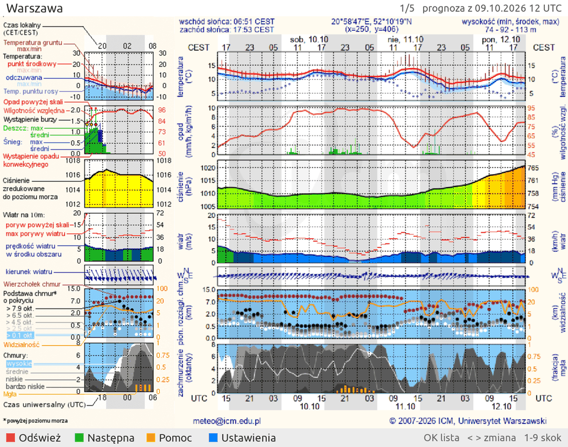
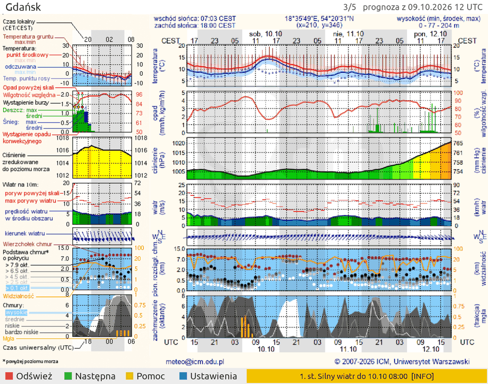
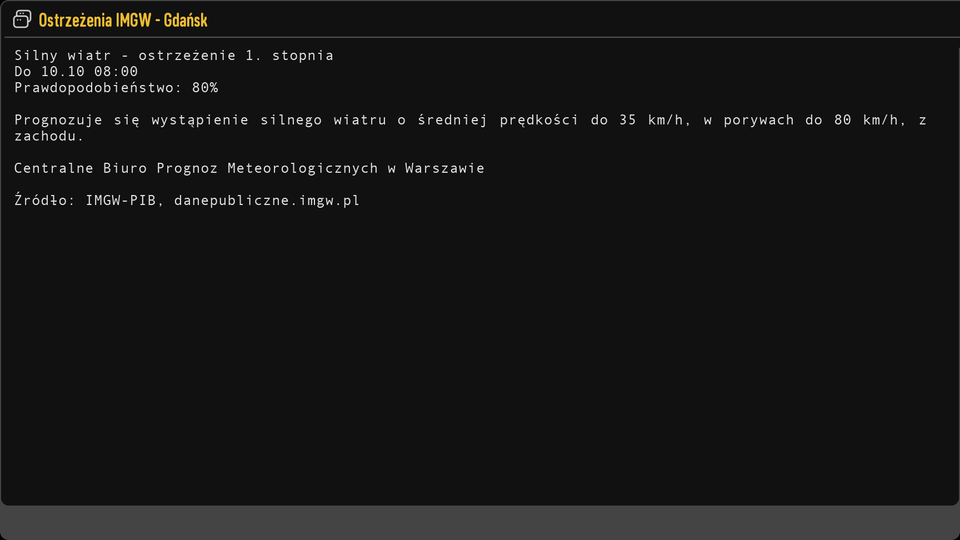
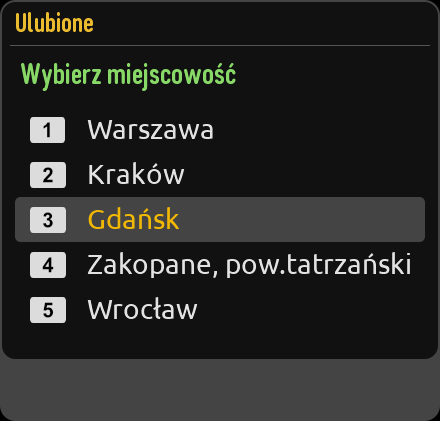
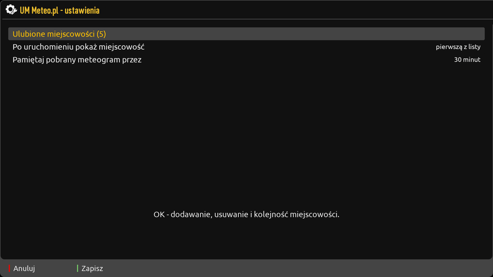
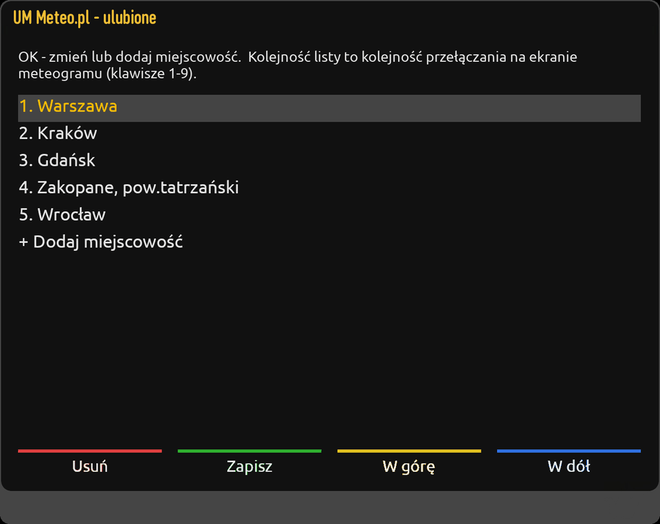
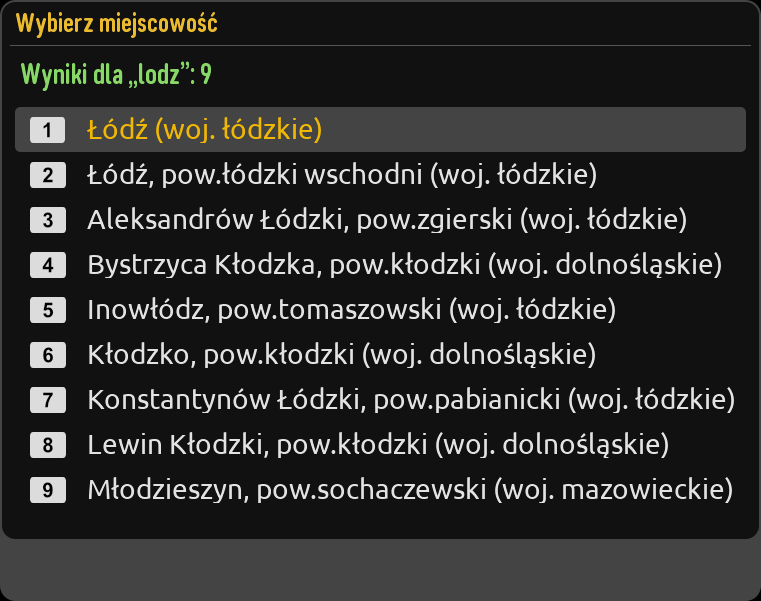

# UM Meteo.pl — meteogram na dekoderze z enigmą2

Wtyczka enigma2 pokazująca **meteogram modelu UM** z [meteo.pl](https://www.meteo.pl)
(ICM, Uniwersytet Warszawski) dla listy ulubionych miejscowości, razem z
**ostrzeżeniami meteorologicznymi IMGW-PIB** dla ich powiatu.



- 2358 miejscowości ze wszystkich województw, z wyszukiwarką, w której wielkość liter
  i polskie znaki nie mają znaczenia
- przełączanie miejscowości strzałkami, CH+/CH−, klawiszami 1–9 albo z listy;
  pobrane meteogramy są pamiętane, więc powrót jest natychmiastowy
- ostrzeżenia IMGW w kolorze stopnia (żółty / pomarańczowy / czerwony), szczegóły pod INFO
- skórka skalowana do rozdzielczości (HD, FullHD, 4K); ustawienia wyglądają jak
  systemowe, bo rysuje je skórka dekodera
- tylko Python 3 i enigma: bez `requests`, PIL czy ImageMagick

## Ostrzeżenia IMGW

Gdy dla powiatu wybranej miejscowości obowiązuje albo jest zapowiedziane ostrzeżenie,
pasek w stopce pokazuje najpoważniejsze z nich. INFO otwiera pełną treść wszystkich.





<sub>Na zrzutach jest prawdziwe ostrzeżenie IMGW z 8.10.2026 (silny wiatr, Trójmiasto i powiat gdański),
z godzinami przesuniętymi na chwilę robienia zrzutu.</sub>

## Ulubione i ustawienia

| Lista ulubionych (OK) | Ustawienia (MENU) |
|---|---|
|  |  |

| Edytor ulubionych | Wyszukiwanie: „lodz” |
|---|---|
|  |  |

W ustawieniach można też wybrać, czy wtyczka startuje od pierwszej czy od ostatnio
oglądanej miejscowości, oraz jak długo pamiętać pobrany meteogram.

## Pilot

| Klawisz | Ekran meteogramu |
|---|---|
| ◀ ▶, CH+ / CH−, ZIELONY | poprzednia / następna miejscowość |
| 1–9, 0 | skok do pozycji z listy, 0 = pierwsza |
| OK, LIST | lista ulubionych |
| CZERWONY | odśwież (z pominięciem pamięci) |
| MENU, NIEBIESKI | ustawienia |
| INFO | szczegóły ostrzeżeń IMGW (bez ostrzeżeń: pomoc) |
| ŻÓŁTY | pomoc |
| EXIT | wyjście |

W edytorze ulubionych: OK zmienia albo dodaje miejscowość, CZERWONY usuwa, ŻÓŁTY / NIEBIESKI
przesuwa, ZIELONY zapisuje. EXIT z niezapisanymi zmianami pyta, co zrobić.

## Instalacja

Wymaga obrazu enigma2 z Pythonem 3. Na dekoderze (telnet/ssh jako root):

```sh
wget -qO- https://raw.githubusercontent.com/areqq/UMMeteoPL/master/install.sh | sh
```

Jeśli `wget` z BusyBoxa zgłasza błąd TLS, użyj `curl` albo Pythona:

```sh
curl -fsSL https://raw.githubusercontent.com/areqq/UMMeteoPL/master/install.sh | sh
python3 -c "import urllib.request as u; print(u.urlopen('https://raw.githubusercontent.com/areqq/UMMeteoPL/master/install.sh').read().decode())" | sh
```

Skrypt pobiera aktualną wersję z GitHuba, a do pobrania używa `wget`, w razie
niepowodzenia `curl`, a na końcu Pythona. Podmienia katalog wtyczki bez `docs`, `tests`
i `tools`, a ustawień nie rusza. Tym samym poleceniem wtyczkę się aktualizuje. Na koniec
trzeba zrestartować GUI. Wtyczka pojawi się w menu wtyczek i w menu rozszerzeń.

Ustawienia są zapisywane w `/etc/enigma2/settings` (`config.plugins.UMMeteoPL.*`), więc
przetrwają aktualizację wtyczki i trafiają do kopii zapasowej ustawień. Lista z
`meteo.ini` starszych wersji jest przenoszona automatycznie.

Przetestowane w kontenerach z enigmą w 1920×1080: OpenPLi (Python 3.11, skórka E2-DarkOS)
i openATV (Python 3.13, MetrixHD).

## Skąd są dane

- **Meteogram:** meteo.pl, model UM. Serwer dokleja nad wykresem baner, który wtyczka
  odcina, dzięki czemu wykres pokrywa się z legendą.
- **Ostrzeżenia:** publiczne API IMGW-PIB
  [`danepubliczne.imgw.pl/api/data/warningsmeteo`](https://danepubliczne.imgw.pl/api/data/warningsmeteo),
  sprawdzane co 10 minut.
- **Powiat miejscowości:** tabela [`teryt.tsv`](teryt.tsv) (id meteo.pl → kod TERYT powiatu)
  zbudowana z państwowego rejestru granic PRG (GUGiK) skryptem
  [`tools/build_teryt.py`](tools/build_teryt.py).

## Dla programistów

| plik | rola |
|---|---|
| `meteogram.py` | adresy meteo.pl, parsowanie strony, pobieranie (bez zależności od enigmy) |
| `alerts.py` | ostrzeżenia IMGW-PIB dla powiatu (bez enigmy) |
| `storage.py` | katalog `woj/*`, wyszukiwarka, (de)serializacja ulubionych (bez enigmy) |
| `settings.py` | `config.plugins.UMMeteoPL`, migracja `meteo.ini` |
| `Meteo.py` | ekran meteogramu |
| `setup.py` | ustawienia (`ConfigListScreen`, wygląd ze skórki `Setup`) |
| `configure.py` | edytor listy ulubionych |
| `keymap.xml` | kontekst `MeteoActions` |

Testy działają na PC bez enigmy. Uruchamia się je z katalogu nadrzędnego:

    python3 -m unittest UMMeteoPL.tests.test_core -v

Pełna instrukcja i historia zmian: [opis.txt](opis.txt). Ten sam tekst pokazuje się na
dekoderze pod klawiszem ŻÓŁTYM.
