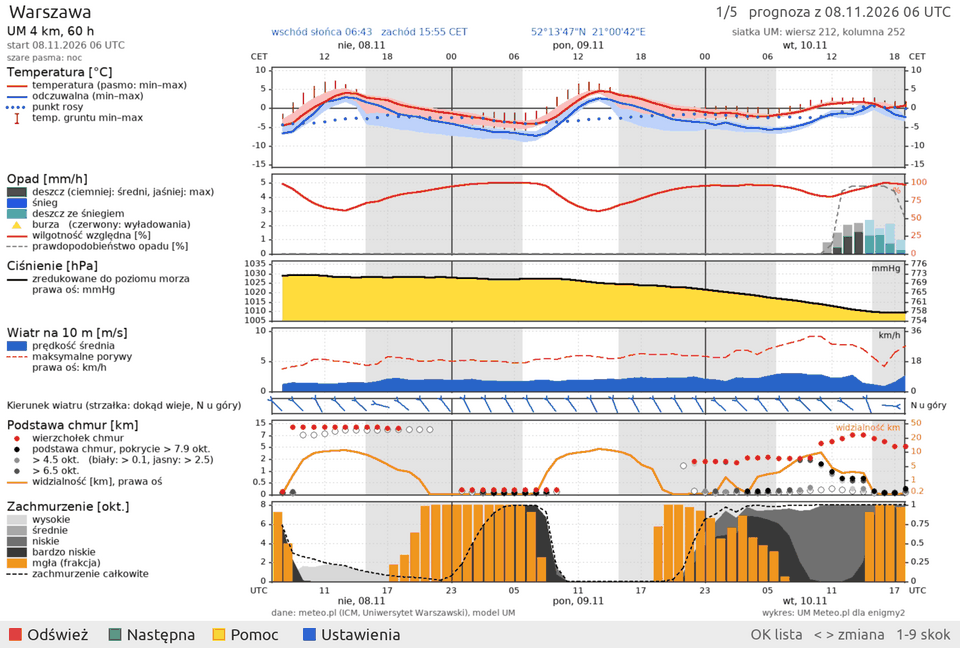
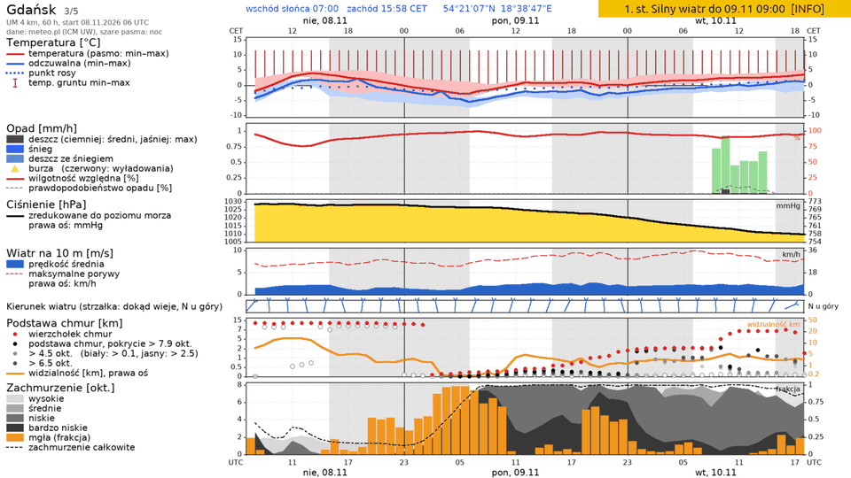
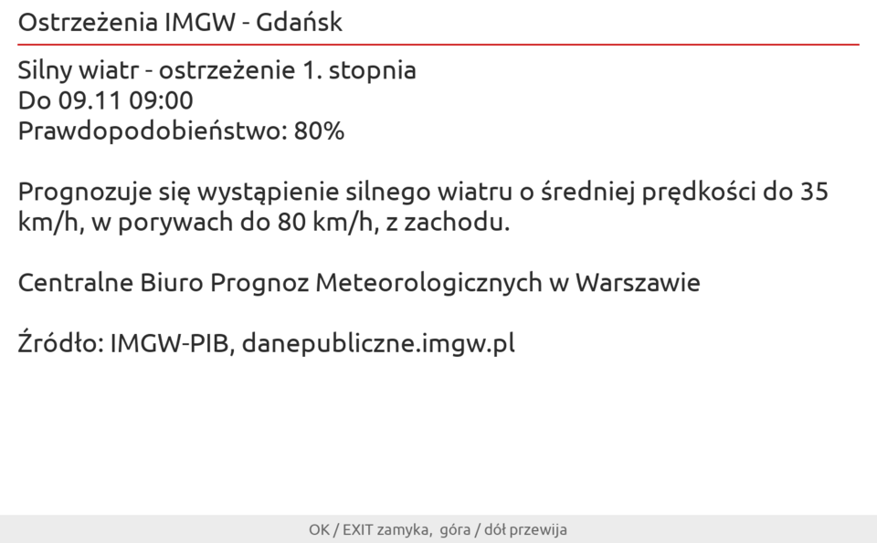
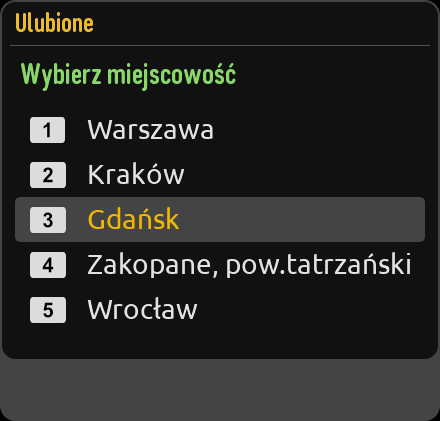
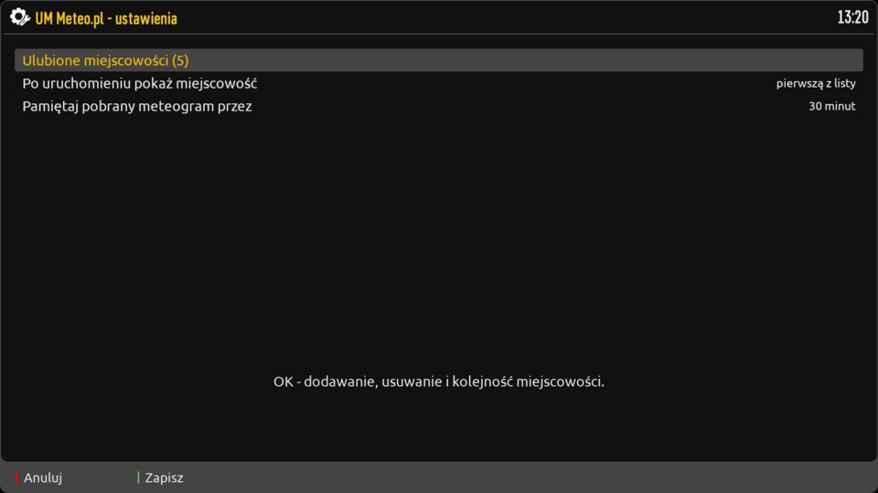
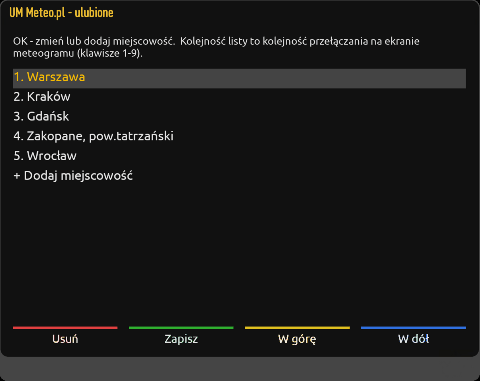
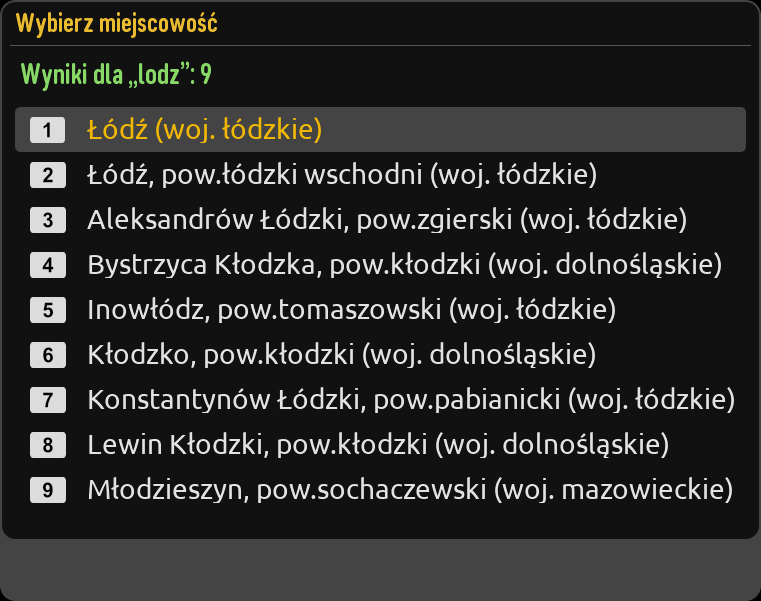

# UM Meteo.pl — meteogram na dekoderze z enigmą2

Wtyczka enigma2 pokazująca **meteogram modelu UM** z danych [meteo.pl](https://www.meteo.pl)
(ICM, Uniwersytet Warszawski) dla listy ulubionych miejscowości, razem z
**ostrzeżeniami meteorologicznymi IMGW-PIB** dla ich powiatu. Od października 2026
stary serwis old.meteo.pl z gotowymi obrazkami nie działa, więc wtyczka pobiera liczby
z tego samego źródła co aplikacja app.meteo.pl i rysuje meteogram sama, w układzie
znanym ze starego serwisu. Pobieraniem i rysowaniem zajmuje się mały program
`ummeteo` napisany w Zigu (statyczna binarka bez zależności), więc nawet na dekoderze
z MIPS-em 750 MHz wykres jest gotowy w ułamku sekundy.



- prognoza UM 4 km na 60 godzin: temperatura (średnia, min–max, odczuwalna, punkt rosy,
  temperatura gruntu), opad (deszcz / śnieg / deszcz ze śniegiem), burze, wilgotność,
  prawdopodobieństwo opadu, ciśnienie, wiatr z porywami i kierunkiem, podstawa i
  wierzchołek chmur, widzialność, zachmurzenie na czterech piętrach, mgła; noc zaznaczona
- wykres na całym ekranie, bez pasków, dużym pismem (do czytania z kanapy), ostry w HD,
  FullHD, WQHD i 4K
- 2358 miejscowości ze wszystkich województw, z wyszukiwarką, w której wielkość liter
  i polskie znaki nie mają znaczenia
- przełączanie miejscowości strzałkami, CH+/CH−, klawiszami 1–9 albo z listy;
  pobrane meteogramy są pamiętane, więc powrót jest natychmiastowy
- ostrzeżenia IMGW w kolorze stopnia (żółty / pomarańczowy / czerwony), szczegóły pod INFO
- skórka skalowana do rozdzielczości (HD, FullHD, 4K); ustawienia wyglądają jak
  systemowe, bo rysuje je skórka dekodera
- ekrany w Pythonie 3 enigmy, meteogram z binarki w Zigu (MIPS, ARM, ARM64, x86-64): bez
  `requests`, PIL czy ImageMagick

## Ostrzeżenia IMGW

Gdy dla powiatu wybranej miejscowości obowiązuje albo jest zapowiedziane ostrzeżenie,
pasek w prawym górnym rogu pokazuje najpoważniejsze z nich. INFO otwiera pełną treść wszystkich
w oknie z dużą czcionką.





<sub>Na zrzutach jest prawdziwe ostrzeżenie IMGW z 8.10.2026 (silny wiatr, Trójmiasto i powiat gdański),
z godzinami przesuniętymi na chwilę robienia zrzutu.</sub>

## Ulubione i ustawienia

| Lista ulubionych (LIST) | Ustawienia (MENU) |
|---|---|
|  |  |

| Edytor ulubionych | Wyszukiwanie: „lodz” |
|---|---|
|  |  |

W ustawieniach można też wybrać, czy wtyczka startuje od pierwszej czy od ostatnio
oglądanej miejscowości, oraz jak długo pamiętać pobrany meteogram.

## Pilot

| Klawisz | Ekran meteogramu |
|---|---|
| ◀ ▶, CH+ / CH−, ZIELONY | poprzednia / następna miejscowość |
| 1–9, 0 | skok do pozycji z listy, 0 = pierwsza |
| LIST | lista ulubionych |
| CZERWONY | odśwież (z pominięciem pamięci) |
| MENU, NIEBIESKI | ustawienia |
| INFO | szczegóły ostrzeżeń IMGW (bez ostrzeżeń: pomoc) |
| ŻÓŁTY | pomoc |
| OK, EXIT | wyjście |

W edytorze ulubionych: OK zmienia albo dodaje miejscowość, CZERWONY usuwa, ŻÓŁTY / NIEBIESKI
przesuwa, ZIELONY zapisuje. EXIT z niezapisanymi zmianami pyta, co zrobić.

## Instalacja

Wymaga obrazu enigma2 z Pythonem 3. Na dekoderze (telnet/ssh jako root):

```sh
wget -qO- https://raw.githubusercontent.com/areqq/UMMeteoPL/master/install.sh | sh
```

Jeśli `wget` z BusyBoxa zgłasza błąd TLS, użyj `curl` albo Pythona:

```sh
curl -fsSL https://raw.githubusercontent.com/areqq/UMMeteoPL/master/install.sh | sh
python3 -c "import urllib.request as u; print(u.urlopen('https://raw.githubusercontent.com/areqq/UMMeteoPL/master/install.sh').read().decode())" | sh
```

Skrypt pobiera opublikowaną wersję (`UMMeteoPL.tar.gz`), sprawdza jej sumę SHA-256
i podmienia katalog wtyczki. Do pobrania używa `wget`, w razie niepowodzenia `curl`,
a na końcu Pythona. Ustawień nie rusza. Na koniec trzeba zrestartować GUI. Wtyczka
pojawi się w menu wtyczek i w menu rozszerzeń.

Ustawienia są zapisywane w `/etc/enigma2/settings` (`config.plugins.UMMeteoPL.*`), więc
przetrwają aktualizację wtyczki i trafiają do kopii zapasowej ustawień. Lista z
`meteo.ini` starszych wersji jest przenoszona automatycznie.

Przetestowane w kontenerach z enigmą w 1920×1080: OpenPLi (Python 3.11, skórka E2-DarkOS)
i openATV (Python 3.13, MetrixHD), oraz na dekoderach Zgemma H3 (MIPS, OpenPLi 9.2)
i Zgemma H8.2H (ARM, OpenPLi 9.2).

## Skąd są dane

- **Prognoza:** meteo.pl (ICM UW), model UM 4 km, 60 godzin, z API meteogramów
  aplikacji app.meteo.pl (JSON z wartościami godzinowymi dla punktu).
- **Współrzędne miejscowości:** tabela [`zig/src/coords.tsv`](zig/src/coords.tsv) (id meteo.pl →
  szerokość, długość) zbudowana z Państwowego Rejestru Nazw Geograficznych PRNG (GUGiK) skryptem
  [`tools/build_coords.py`](tools/build_coords.py), wkompilowana w `ummeteo`.
- **Ostrzeżenia:** publiczne API IMGW-PIB
  [`danepubliczne.imgw.pl/api/data/warningsmeteo`](https://danepubliczne.imgw.pl/api/data/warningsmeteo),
  sprawdzane co 10 minut.
- **Powiat miejscowości:** tabela [`teryt.tsv`](teryt.tsv) (id meteo.pl → kod TERYT powiatu)
  zbudowana z państwowego rejestru granic PRG (GUGiK) skryptem
  [`tools/build_teryt.py`](tools/build_teryt.py).

## Dla programistów

| plik | rola |
|---|---|
| `zig/` | `ummeteo`: pobieranie prognozy z API meteo.pl i rysowanie meteogramu do PNG, czysty Zig 0.17.1 ([zig/README.md](zig/README.md)) |
| `renderer.py` | uruchamia `bin/ummeteo-<arch>` dla dekodera i czyta jego wynik (bez enigmy) |
| `alerts.py` | ostrzeżenia IMGW-PIB dla powiatu (bez enigmy) |
| `storage.py` | katalog `woj/*`, wyszukiwarka, (de)serializacja ulubionych (bez enigmy) |
| `settings.py` | `config.plugins.UMMeteoPL`, migracja `meteo.ini` |
| `update.py`, `version.py` | aktualizacja w tle co 8 h z serwera wtyczki |
| `Meteo.py` | ekran meteogramu |
| `setup.py` | ustawienia (`ConfigListScreen`, wygląd ze skórki `Setup`) |
| `configure.py` | edytor listy ulubionych |
| `keymap.xml` | kontekst `MeteoActions` |
| `tools/` | odtwarzanie `zig/src/coords.tsv`, `teryt.tsv`, `zig/src/glyphs.bin` |

Binarki `bin/ummeteo-<arch>` (mipsel, arm, aarch64, x86_64) nie są w gicie: buduje je
`scripts/publish.sh` (`zig build release`, kompilator Zig 0.17.1 wskazany przez `ZIG`
w `scripts/publish.local`), a `install.sh` zostawia na dekoderze tylko tę dla jego procesora.
Na ARM-ie jest jedna binarka dla wszystkich ARMv7 (Cortex-A7 bez NEON i z 16 rejestrami D,
bo tyle ma np. Zgemma H8.2H).

Wtyczka co 8 godzin sprawdza w tle plik `version` na serwerze wtyczki i przy innej
wersji uruchamia z niego `install.sh`. Adres serwera jest
w kodzie zaszyfrowany (`BASE_URL_ENC` w `update.py`, `BASE_ENC` w `install.sh`). Wydanie: podbić `version.py`, zacommitować i uruchomić
`scripts/publish.sh`. Skrypt wysyła przez FTP `git archive HEAD` i stronę
`docs/index.html` ze zrzutami. Cel FTP z hasłem i publiczny adres trzyma
w `scripts/publish.local`, nigdy w gicie.

Testy działają na PC bez enigmy. Uruchamia się je z katalogu nadrzędnego:

    python3 -m unittest UMMeteoPL.tests.test_core -v
    cd UMMeteoPL/zig && zig build test

Test w Zigu wymaga, żeby wykres był piksel w piksel taki sam jak referencyjny obraz
dawnej wersji w Pythonie (suma SHA-256 pikseli).

Pełna instrukcja i historia zmian: [opis.txt](opis.txt). Ten sam tekst pokazuje się na
dekoderze pod klawiszem ŻÓŁTYM.
